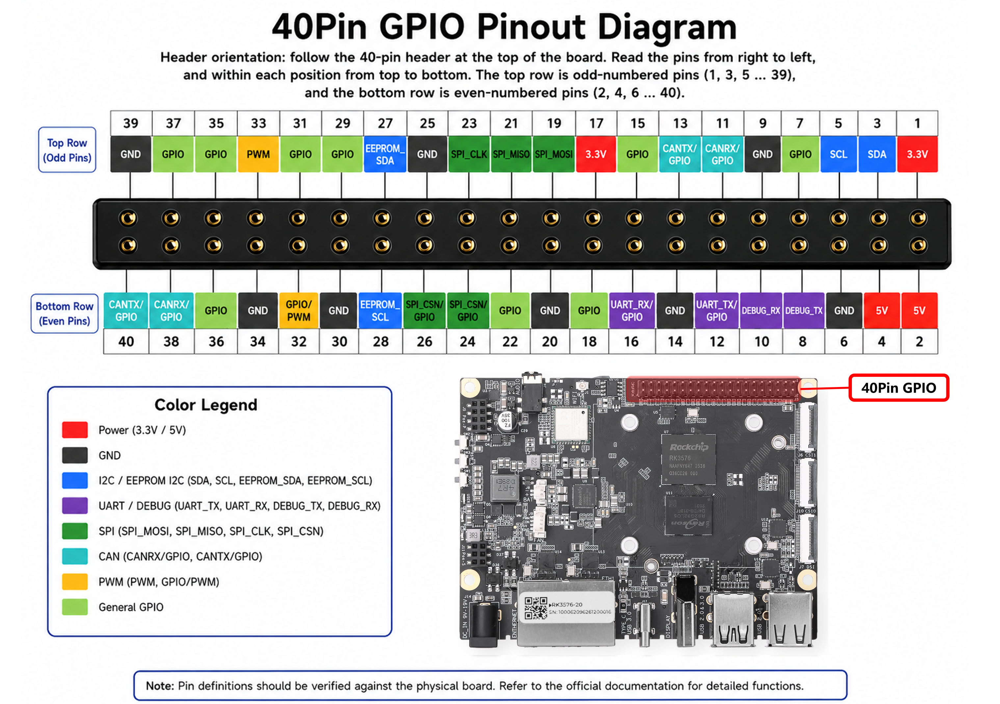

[English](official-pinout.md) | [简体中文](official-pinout.zh-CN.md)

# 40-pin 官方标注

适用 RK3576-20/30 整机 DevKit，不适用于 Module Dev Kit。本页按 Seeed 官方接口页面的 `image29.png` 人工目视转录，保留标签名称，不由标签推导 Linux GPIO 编号。图像本身未注明 PCB revision；放入 V1.0 资料目录是与现有板级资料关联，不代表图像独立证明版本。

[官方接口说明](https://sensecraft.seeed.cc/ai-lab/en/tutorials/rk/edge-ai-computer/rk3576/interface-usage-guidelines/use-recomputer-rk3576-hardware-interfaces-and-fan-control) · [官方原图](https://files.seeedstudio.com/wiki/reComputer_RK/ai_lab/tutorials/image29.png) · [结构化针脚表](official-pinout.yaml)

## 方向

以官方板卡照片的元件面为参考，40-pin 位于板卡上边缘。原图上排为奇数针，左到右是 39→1；下排为偶数针，左到右是 40→2，因此原图右端是 1/2。现场板卡的朝向和 1 号针仍需核对。

下表为便于查找改按 1→40 升序排列，不是原图的左右摆放顺序。

| 奇数针脚 | 官方标注 | 偶数针脚 | 官方标注 |
|---|---|---|---|
| 1 | `3.3V` | 2 | `5V` |
| 3 | `SDA` | 4 | `5V` |
| 5 | `SCL` | 6 | `GND` |
| 7 | `GPIO` | 8 | `DEBUG_TX` |
| 9 | `GND` | 10 | `DEBUG_RX` |
| 11 | `CANRX/GPIO` | 12 | `UART_TX/GPIO` |
| 13 | `CANTX/GPIO` | 14 | `GND` |
| 15 | `GPIO` | 16 | `UART_RX/GPIO` |
| 17 | `3.3V` | 18 | `GPIO` |
| 19 | `SPI_MOSI` | 20 | `GND` |
| 21 | `SPI_MISO` | 22 | `GPIO` |
| 23 | `SPI_CLK` | 24 | `SPI_CSN/GPIO` |
| 25 | `GND` | 26 | `SPI_CSN/GPIO` |
| 27 | `EEPROM_SDA` | 28 | `EEPROM_SCL` |
| 29 | `GPIO` | 30 | `GND` |
| 31 | `GPIO` | 32 | `GPIO/PWM` |
| 33 | `PWM` | 34 | `GND` |
| 35 | `GPIO` | 36 | `GPIO` |
| 37 | `GPIO` | 38 | `CANRX/GPIO` |
| 39 | `GND` | 40 | `CANTX/GPIO` |

## 标注可以确认的范围

- 电源标签：1/17 为 3.3V，2/4 为 5V；GND 为 6/9/14/20/25/30/34/39。这是官方图的声明，文档标注不能代替当前电气核对；5V 电源针不表示 GPIO 可以承受 5V。
- 通信标签：3/5 为 SDA/SCL，8/10 为 DEBUG_TX/RX，12/16 为 UART_TX/RX，19/21/23 为 SPI_MOSI/MISO/CLK，24/26 均写 SPI_CSN/GPIO；11/13 和 38/40 分别标有 CAN RX/TX。
- PWM 标签：32 为 GPIO/PWM，33 为 PWM。图中没有给出两者的控制器/通道，不能据此声明存在两个独立 PWM 通道。
- 27/28 标为 EEPROM_SDA/SCL，不能从图中确定总线编号、是否共享内部 EEPROM 或是否可用于客户 I2C。
- 图中的 CAN/UART/I2C 标签没有给出控制器编号，两个 SPI_CSN 没给出 CS 编号。不要根据排列直接绑定 CAN0/1、UART3/5 或 CS0/1；CAN TX/RX 也不是 CAN_H/CAN_L。

## 原理图补充与差异

上述表格保留官方图片的原始标签。新增 [V1.0 J3 原理图映射](schematic-mapping.zh-CN.md) 已补齐 40 个位置的 net、28 个信号 pad、GPIO bank/局部 offset、复用候选和电平转换路径；这是另一个有明确来源的依据，不把图片本身未标明的信息混入原始转录。

- **26 脚**：图片为 SPI_CSN/GPIO，原理图接 GPIO0_C7，不能当作 SPI3 CS0；24 脚为 SPI3 m1 CS1。
- **27/28**：原理图为 I2C4 m3，连接共享板内总线。EEPROM 标签不表示独立客户总线。
- **32/33**：文档候选分别为 PWM2_CH0_M0 / PWM2_CH6_M0；不等于当前已启用。

## 与 Linux 资料共同使用

[接口来源与冲突](interfaces.zh-CN.md) 中的 28 个 `PIN_*` 条目仍是 Linux 标签来源声明，不能拿其 bank/offset 自动补入本表。应分别检查当前pad的consumer与mux，不能从标签推断物理针脚占用。

官方标签回答“哪个物理位置标注什么功能”，运行时快照回答“当前系统启用了什么”。静态pin-to-net与电源域资料见原理图映射；实板朝向、连线、电气和外接负载仍需确认。本页不授权启用overlay或输出电平。
