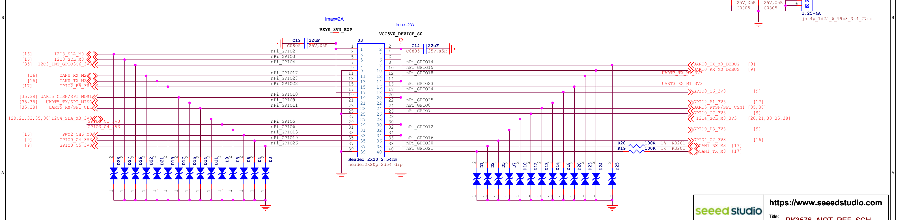
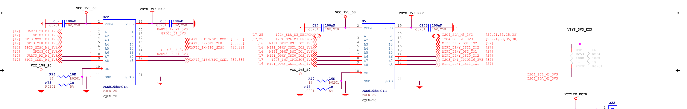

[English](schematic-mapping.md) | [简体中文](schematic-mapping.zh-CN.md)

# V1.0 J3: schematic-to-SoC40-pin mapping

Applies to the RK3576-20/30 full-system DevKit V1.0 reference design. Trace J3 and U5/U22 on official PDF sheet 35, cross-checking pads, domains, and cached pinctrl against sheets9/16/17. Sheet 25 covers the EEPROM branch. A PDF date is not an independent target PCB revision measurement.

This is static schematic/source mapping, not a device measurement or runtime record. Confirm product, revision, orientation, and external circuit before wiring. See [structured 40-pin data](schematic-mapping.yaml) and [original labels](official-pinout.md).

## Signal mapping

An offset is local to the specified GPIO bank. gpio0/2/3/4 are controller identities, not permanent /dev/gpiochipN names. Resolve actual devices from DT address, label, and line count each time. Functions are source mux candidates, not current enablement or permission for simultaneous use.

| J3 pin | Schematic header net | SoC pad | Controller / offset | Path | Source mux candidates |
|---|---|---|---|---|---|
| 3 | `I2C3_SDA_M0` | `GPIO4_B4` | gpio4 / 12 | Direct 3.3V | i2c3m0:SDA |
| 5 | `I2C3_SCL_M0` | `GPIO4_B5` | gpio4 / 13 | Direct 3.3V | i2c3m0:SCL |
| 7 | `I2C3_INT_GPIO3C6_3V3` | `GPIO3_C6` | gpio3 / 22 | U5:A7-B7, 1.8↔3.3V | GPIO |
| 8 | `UART0_TX_M0_DEBUG` | `GPIO0_D4` | gpio0 / 28 | Direct 3.3V | uart0m0:TX |
| 10 | `UART0_RX_M0_DEBUG` | `GPIO0_D5` | gpio0 / 29 | Direct 3.3V | uart0m0:RX |
| 11 | `CAN0_RX_M2` | `GPIO4_A6` | gpio4 / 6 | Direct 3.3V | can0m2_pins:RX |
| 12 | `UART3_TX_M1_3V3` | `GPIO4_A0` | gpio4 / 0 | U22:A1-B1, 1.8↔3.3V | uart3m1:TX |
| 13 | `CAN0_TX_M2` | `GPIO4_A4` | gpio4 / 4 | Direct 3.3V | can0m2_pins:TX |
| 15 | `GPIO2_B5_3V3` | `GPIO2_B5` | gpio2 / 13 | Direct 3.3V | GPIO |
| 16 | `UART3_RX_M1_3V3` | `GPIO4_A1` | gpio4 / 1 | U22:A7-B7, 1.8↔3.3V | uart3m1:RX |
| 18 | `GPIO0_C6_3V3` | `GPIO0_C6` | gpio0 / 22 | Direct 3.3V | GPIO |
| 19 | `UART5_CTSN/SPI_MOSI` | `GPIO3_D6` | gpio3 / 30 | U22:A3-B3, 1.8↔3.3V | spi3m1_pins:MOSI, uart5m0_ctsn:CTS |
| 21 | `UART5_TX/SPI_MISO` | `GPIO3_D5` | gpio3 / 29 | U22:A5-B5, 1.8↔3.3V | spi3m1_pins:MISO, uart5m0:TX |
| 22 | `GPIO2_B1_3V3` | `GPIO2_B1` | gpio2 / 9 | Direct 3.3V | GPIO |
| 23 | `UART5_RX/SPI_CLK` | `GPIO3_D4` | gpio3 / 28 | U22:A4-B4, 1.8↔3.3V | spi3m1_pins:CLK, uart5m0:RX |
| 24 | `UART5_RTSN/SPI_CSN1` | `GPIO3_D7` | gpio3 / 31 | U22:A8-B8, 1.8↔3.3V | spi3m1_csn1:CS1, uart5m0_rtsn:RTS |
| 26 | `GPIO0_C7_3V3` | `GPIO0_C7` | gpio0 / 23 | Direct 3.3V | GPIO |
| 27 | `I2C4_SDA_M3_3V3` | `GPIO3_B7` | gpio3 / 15 | U5:A1-B1, 1.8↔3.3V | i2c4m3:SDA |
| 28 | `I2C4_SCL_M3_3V3` | `GPIO3_C0` | gpio3 / 16 | U5:A2-B2, 1.8↔3.3V | i2c4m3:SCL |
| 29 | `GPIO3_C1_3V3` | `GPIO3_C1` | gpio3 / 17 | U22:A2-B2, 1.8↔3.3V | GPIO |
| 31 | `GPIO3_C4_3V3` | `GPIO3_C4` | gpio3 / 20 | U22:A6-B6, 1.8↔3.3V | GPIO |
| 32 | `GPIO0_D3_3V3` | `GPIO0_D3` | gpio0 / 27 | Direct 3.3V | pwm2m0_ch0:PWM |
| 33 | `PWM2_CH6_M0` | `GPIO4_A7` | gpio4 / 7 | Direct 3.3V | pwm2m0_ch6:PWM |
| 35 | `GPIO0_C4_3V3` | `GPIO0_C4` | gpio0 / 20 | Direct 3.3V | GPIO |
| 36 | `GPIO4_C7_3V3` | `GPIO4_C7` | gpio4 / 23 | Direct 3.3V | GPIO |
| 37 | `GPIO0_C5_3V3` | `GPIO0_C5` | gpio0 / 21 | Direct 3.3V | GPIO |
| 38 | `CAN1_RX_M3` | `GPIO3_A3` | gpio3 / 3 | R20:100ohm series | can1m3_pins:RX |
| 40 | `CAN1_TX_M3` | `GPIO3_A2` | gpio3 / 2 | R19:100ohm series | can1m3_pins:TX |

## Sharing and mux constraints

- J3-24 is SPI3 m1 CS1. J3-26 routes to GPIO0_C7, not SPI3 CS0 despite the image label. Source CS0 GPIO3_B6 goes through R89 to GMAC0_TXCLK, not J3.
- J3-27/28 are I2C4 m3 via U5 to a shared onboard bus. I2C controller 2ac70000 is distinct from GPIO3 bank 2ae30000. J3-3/5 are I2C3 m0. Confirm an external device's fixed address; do not scan or force kernel-owned addresses.
- J3-32 is GPIO0_D3/PWM2_CH0_M0;33 is GPIO4_A7/PWM2_CH6_M0. Resolve current providers rather than using the fan PWM.
- Inspect current mux, consumer, and direction. Unclaimed does not establish electrical safety or output authorization.

## Power and levels

-1/17 connect to VSYS_3V3_EXP, nominal 3.3V;2/4 to VCC5V0_DEVICE_S0, nominal 5V.6/9/14/20/25/30/34/39 are GND.
- Schematic header signal levels are nominal 3.3V. U5/U22 paths have1.8V SoC sides: do not bypass translators or infer header voltage from SoC rails. Both are labeled TXS0108E; actual load, direction changes, and speed require validation.
- Static mapping does not establish measured voltage, maximum input,5V tolerance, or drive current.5V power pins do not establish5V-tolerant signals. Rail Imax=2A is not a per-pin or remaining-budget promise.
- CAN pins carry controller TX/RX logic, not CAN_H/CAN_L.

## Runtime boundaries

Check current fiq-debugger, SPI3, I2C4, and other owners rather than importing an old GPIO listing. Unclaimed metadata does not prove wiring, direction, electrical safety, or availability. A system function associated with an incorrect PIN_* pad cannot be attributed to the same-numbered J3 pin.

After selecting pins/peripherals and confirming electrical/load conditions, perform only the corresponding bounded functional check. Static documentation does not request lines, output levels, enable overlays, scan I2C, modify services, or reboot.

## Official schematic excerpts

The following are aspect-preserving crops from official sheet 35, not redrawn connections. Trace full sheets9/16/17/25/35 through source.seeed-schematic-v1's official URL and digest. Schematic layout is not physical board orientation. Original source artwork is retained unchanged; English explanations above provide the interpretation.

