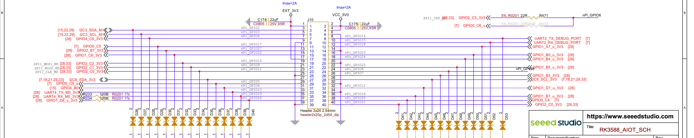
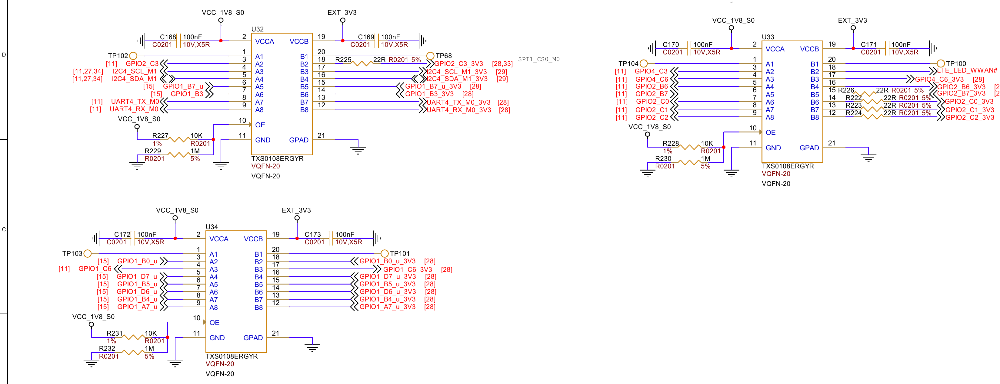

[English](interfaces.md) | [简体中文](interfaces.zh-CN.md)

# RK3588 V1.0 J10: all 40 positions

All 40 physical positions are covered below using the official V1.0 schematic. This is a documentary review, not an all-pin hardware test. Confirm the actual PCB revision, connector orientation, assembly and active software configuration per task. Do not use the RK3576 J3 table for this board.

**J10-23 and J10-40 share one net:** official V1.0 schematic sheet 28 connects both to `GPIO2_C0_3V3`, corresponding to `GPIO2_C0`, gpio2 local offset 16 and the SPI1 CLK M0 candidate. They are not independent GPIO lines and cannot be set to opposing levels. The header has 28 signal positions and 27 distinct GPIO pads.

All 28 signal positions have GPIO-capable SoC pads in the schematic. This does not mean they are free for GPIO now: I2C buses are shared, UART2 is a debug path, SPI1 has another expansion route, and mux/driver ownership must be checked. Four power positions and eight grounds are not GPIO. See the machine-readable [interfaces.yaml](interfaces.yaml).

## Full physical pin table

`gpioN / offset` identifies a DT controller label and a **bank-local** line offset, not `/dev/gpiochipN`. The electrical path column is from SoC to header; A/B numbers are translator channels. All signal header sides are nominally 3.3V. Candidate alternate functions require matching pinctrl and driver configuration; the list is not exhaustive.

| J10 pin | Schematic header net | SoC pad; gpioN / local offset | Electrical path | Selected function / restriction |
|---|---|---|---|---|
| 1 | `EXT_3V3` | — | 3.3V supply | Power; not GPIO |
| 2 | `VCC_5V0` | — | 5V supply | Power; not GPIO |
| 3 | `I2C3_SDA_M1` | `GPIO3_C0`; gpio3 / 16 | Direct 3.3V | I2C3 SDA M1; shared bus |
| 4 | `VCC_5V0` | — | 5V supply | Power; not GPIO |
| 5 | `I2C3_SCL_M1` | `GPIO3_B7`; gpio3 / 15 | Direct 3.3V | I2C3 SCL M1; shared bus |
| 6 | `GND` | — | GND | Ground; not GPIO |
| 7 | `GPIO4_C6_3V3` | `GPIO4_C6`; gpio4 / 22 | 1.8V → U33 A3/B3 → 3.3V | GPIO candidate |
| 8 | `UART2_TX_DEBUG_PORT` | `GPIO0_B5`; gpio0 / 13 | Direct 3.3V | UART2 TX M0 (debug) |
| 9 | `GND` | — | GND | Ground; not GPIO |
| 10 | `UART2_RX_DEBUG_PORT` | `GPIO0_B6`; gpio0 / 14 | Direct 3.3V | UART2 RX M0 (debug) |
| 11 | `GPIO0_C0` | `GPIO0_C0`; gpio0 / 16 | Direct 3.3V | PWM1 M0 |
| 12 | `GPIO1_A7_u_3V3` | `GPIO1_A7`; gpio1 / 7 | 1.8V → U34 A8/B8 → 3.3V | PWM3 IR M3 |
| 13 | `GPIO2_B7_3V3` | `GPIO2_B7`; gpio2 / 15 | 1.8V → U33 A5/B5 → 3.3V; R226 22Ω | GPIO candidate |
| 14 | `GND` | — | GND | Ground; not GPIO |
| 15 | `GPIO1_C6_3V3` | `GPIO1_C6`; gpio1 / 22 | 1.8V → U34 A3/B3 → 3.3V | GPIO candidate |
| 16 | `GPIO1_B0_u_3V3` | `GPIO1_B0`; gpio1 / 8 | 1.8V → U34 A2/B2 → 3.3V | GPIO candidate |
| 17 | `EXT_3V3` | — | 3.3V supply | Power; not GPIO |
| 18 | `GPIO1_B4_u_3V3` | `GPIO1_B4`; gpio1 / 12 | 1.8V → U34 A7/B7 → 3.3V | GPIO candidate |
| 19 | `GPIO2_C2_3V3` | `GPIO2_C2`; gpio2 / 18 | 1.8V → U33 A8/B8 → 3.3V; R224 22Ω | SPI1 MOSI M0 |
| 20 | `GND` | — | GND | Ground; not GPIO |
| 21 | `GPIO2_C1_3V3` | `GPIO2_C1`; gpio2 / 17 | 1.8V → U33 A7/B7 → 3.3V; R223 22Ω | SPI1 MISO M0 |
| 22 | `GPIO1_B5_u_3V3` | `GPIO1_B5`; gpio1 / 13 | 1.8V → U34 A5/B5 → 3.3V | GPIO candidate |
| 23 | `GPIO2_C0_3V3` | `GPIO2_C0`; gpio2 / 16 | 1.8V → U33 A6/B6 → 3.3V; R222 22Ω | SPI1 CLK M0; same net as 40, not independent |
| 24 | `nPi_GPIO8` | `GPIO2_C3`; gpio2 / 19 | 1.8V → U32 A2/B2 → 3.3V; R225 22Ω, R471 22Ω | SPI1 CS0 M0; R471 populated, R472 DNP |
| 25 | `GND` | — | GND | Ground; not GPIO |
| 26 | `GPIO1_B3_3V3` | `GPIO1_B3`; gpio1 / 11 | 1.8V → U32 A6/B6 → 3.3V | GPIO candidate; not SPI1 CS1 |
| 27 | `I2C6_SDA_3V3` | `GPIO0_C7`; gpio0 / 23 | Direct 3.3V | I2C6 SDA M0; shared bus |
| 28 | `I2C6_SCL_3V3` | `GPIO0_D0`; gpio0 / 24 | Direct 3.3V | I2C6 SCL M0; shared bus |
| 29 | `GPIO0_C5_u` | `GPIO0_C5`; gpio0 / 21 | Direct 3.3V | PWM4 M0 |
| 30 | `GND` | — | GND | Ground; not GPIO |
| 31 | `GPIO4_B0` | `GPIO4_B0`; gpio4 / 8 | Direct 3.3V | GPIO candidate |
| 32 | `GPIO1_D7_u_3V3` | `GPIO1_D7`; gpio1 / 31 | 1.8V → U34 A4/B4 → 3.3V | GPIO candidate |
| 33 | `UART4_TX_M0_3V3` | `GPIO1_D2`; gpio1 / 26 | 1.8V → U32 A7/B7 → 3.3V | UART4 TX M0; PWM0 M1 |
| 34 | `GND` | — | GND | Ground; not GPIO |
| 35 | `UART4_RX_M0_3V3` | `GPIO1_D3`; gpio1 / 27 | 1.8V → U32 A8/B8 → 3.3V; R233 100Ω | UART4 RX M0; PWM1 M1 |
| 36 | `GPIO1_B7_u_3V3` | `GPIO1_B7`; gpio1 / 15 | 1.8V → U32 A5/B5 → 3.3V | GPIO candidate |
| 37 | `GPIO1_D6_u_3V3` | `GPIO1_D6`; gpio1 / 30 | 1.8V → U34 A6/B6 → 3.3V; R234 100Ω | GPIO candidate |
| 38 | `GPIO0_C4` | `GPIO0_C4`; gpio0 / 20 | Direct 3.3V | PWM2 M0; controller also used by fan via M2 |
| 39 | `GND` | — | GND | Ground; not GPIO |
| 40 | `GPIO2_C0_3V3` | `GPIO2_C0`; gpio2 / 16 | 1.8V → U33 A6/B6 → 3.3V; R222 22Ω | SPI1 CLK M0; same net as 23, not independent |

## Electrical paths and routing notes

- U32/U33/U34 are TXS0108ERGYR translators: VCCA=`VCC_1V8_S0`, VCCB=`EXT_3V3`. GPIO1_C6 is in the fixed 1.8V VCCIO1 domain; GPIO2_B7/C0/C1/C2/C3 and GPIO4_C6 are in the fixed 1.8V VCCIO3 domain. The relevant VCCIO4 pads are supplied at 1.8V on this board. PMUIO2 is supplied at 3.3V through R199; the relevant VCCIO5/VCCIO6 pads are also supplied at 3.3V. Do not equate the SoC-side voltage with header voltage.
- **J10-15 correction:** U34 A3 is package pin 4 and B3 is package pin 17. The earlier reference incorrectly said pin 5/pin 16. The SoC pad remains GPIO1_C6, gpio1 at `fec20000`, local offset 22. This correction does not change that GPIO mapping.
- **J10-24:** `nPi_GPIO8` reaches GPIO2_C3 via populated R471 (22Ω), R225 (22Ω) and U32 B2/A2. The alternative branch through R472 (22Ω) to GPIO0_C6 is marked **DNP**; it is not a second active GPIO route in this schematic. `nPi_GPIO8` is not a Rockchip GPIO/line-offset number. Check actual assembly if reworked.
- Schematic ESD protection is not proof of 5V tolerance. Maximum safe input voltage, per-pin output current and externally available rail current remain unqualified here; power-rail design annotations are not a guaranteed accessory power budget. No hardware operation is authorized by this static table.

## Peripheral groups and conflicts

- **I2C3 M1, pins 3/5:** SDA=GPIO3_C0, SCL=GPIO3_B7; R465/R466 are 2.2k pullups to `VCC_3V3_S0` (sheet 15). The same nets reach USB hub control (sheet 22) and a camera connector (sheet 29). Check the live adapter, attached devices and kernel clients before use; do not turn an active shared bus into push-pull GPIO or perform blind bus-wide probing.
- **I2C6 M0, pins 27/28:** SDA=GPIO0_C7, SCL=GPIO0_D0. R5067/R5068 are 2.2k pullups to `VCC_3V3_S3` (sheet 7). The bus includes Type-C FUSB302 at 0x22 and PCF8563 RTC at 0x51, plus other connectors; it is not exclusive to an external sensor. Resolve the actual I2C adapter rather than assuming a `/dev/i2c-N` number.
- **SPI1 M0:** MOSI=19, MISO=21, CLK=23 and CS0=24, with a shared expansion route on sheet 33. Pin 40 shares the CLK net with pin 23 and cannot be controlled independently. Pin 26 is GPIO1_B3, **not** SPI1 CS1; the pinctrl source places CS1 M0 on GPIO2_C4. The cached board DTS enables SPI1/spidev, which is not evidence of the current device configuration.
- **UART:** pins 8/10 are UART2 M0 TX/RX debug nets; check console/debugger users before repurpose. Pins 33/35 are UART4 M0 TX/RX through U32 (RX also has R233 100Ω). Discover the current tty/controller and ownership; pin labels do not establish an enabled serial port.
- **PWM candidates:** pin 11 PWM1 M0, pin 12 PWM3 IR M3, pin 29 PWM4 M0, pin 33 PWM0 M1, pin 35 PWM1 M1 and pin 38 PWM2 M0. PWM1 on 11/35 is the same controller with alternative routes. Cached vendor DTS assigns PWM2 M2 on GPIO4_C2 to the cooling fan; pin 38's PWM2 M0 cannot be treated as an independent PWM controller or enabled by disabling cooling. GPIO4_C2 is not J10-38.

## Resolve Linux identities at runtime

The YAML gives DT controller nodes for every schematic signal: gpio0=`fd8a0000`, gpio1=`fec20000`, gpio2=`fec30000`, gpio3=`fec40000`, gpio4=`fec50000`, each with 32 local lines. Resolve the actual `/dev/gpiochip*` from DT `of_node`/label and line count; never assume chip numbering. A bank-local offset is `8 × group(A=0,B=1,C=2,D=3) + bit`; pin 15 C6 is 22, not the pinctrl debug index 54.

For the 28 signal positions, the cached vendor DTS defines 26 matching-number `PIN_*` labels: 24 disagree with the schematic and only PIN_8/PIN_10 agree; PIN_22/PIN_37 are absent. For example `PIN_15` labels GPIO3_C0, whereas physical J10-15 is GPIO1_C6; GPIO3_C0 belongs to J10-3 in the schematic. Do not run `gpiofind PIN_15` as a substitute for routing evidence. Compare current mux, consumer/owner, permissions and wiring before requesting a line. Releasing a line to input does not promise a low voltage.

## Source excerpts

[Official V1.0 schematic](https://files.seeedstudio.com/wiki/reComputer_RK/Documents/recomputer_rk3588/RECOMPUTER_RK3588_V10_0119.pdf), sheets 7/11/15/28; shared routes 22/29/33. Source hashes, scope and the cached RK3588 pinctrl/DTS locations are recorded in [the source registry](../../../../../sources/index.yaml). The cache directory contains `rk3576` in its name, but the reviewed files are explicitly `rk3588*.dts[i]`; no RK3576 physical pinout was reused.

For user wiring, see [diagram guidance and AHT20 examples](../../../../../common/wiring-diagrams.md) for physical header locations and explicit wire endpoints on this board.

Pin locators must follow the board view in [wiring-layout.yaml](wiring-layout.yaml): component side facing viewer, header at top, upper row39→1 and lower row40→2 left-to-right, pins1/2 at right. Do not substitute a generic vertical pin grid.
