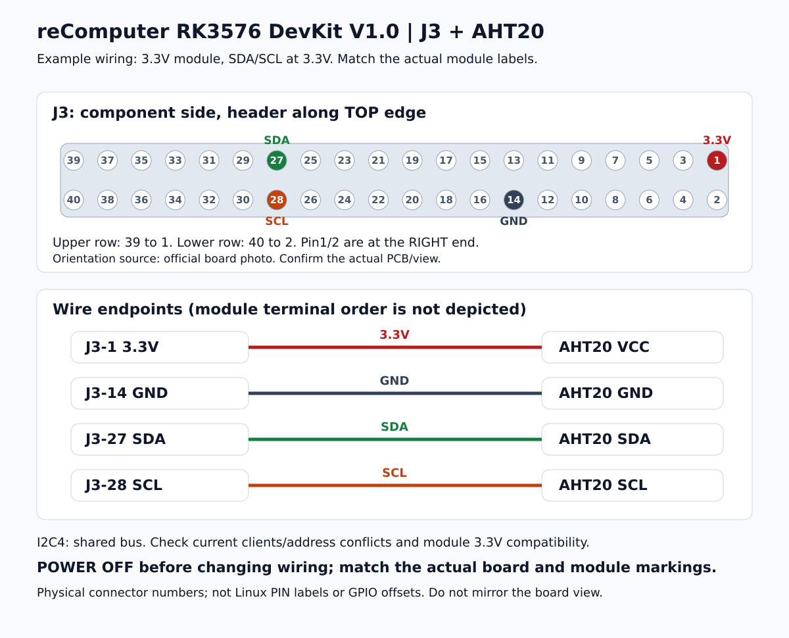
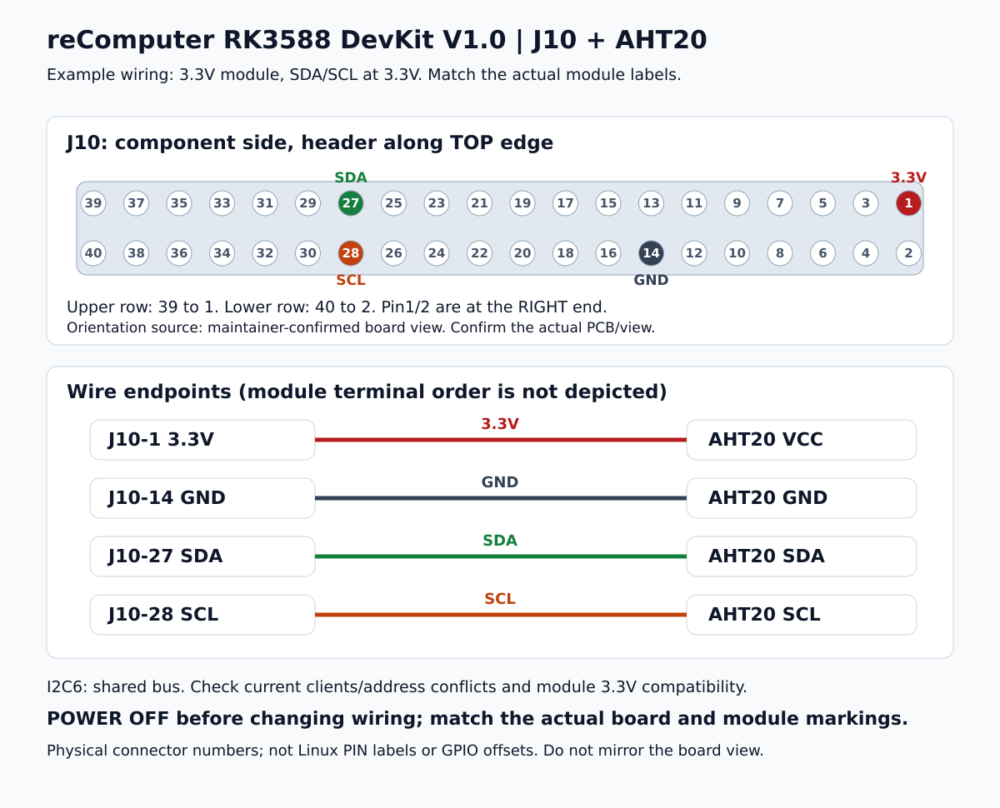

[English](wiring-diagrams.md) | [简体中文](wiring-diagrams.zh-CN.md)

# Show users how to wire the actual task

When the task requires the user to connect a peripheral or measurement instrument, provide a task-specific wiring diagram and a short connection table before asking them to wire it. Use the user's language. A capability-only question needs a diagram only when it helps; do not turn it into a hardware operation.

## What a useful diagram shows

- Name the exact board/revision and connector. RK3576 DevKit V1.0 uses **J3**; RK3588 DevKit V1.0 uses **J10**. A shared SoC family or Raspberry Pi-style header does not establish compatible wiring.
- Show physical pin numbers and signal labels on both ends, plus supply and signal voltage. Never use a Linux `PIN_*` label, gpiochip number or GPIO offset as the connector position.
- Pair a header location view matching the actual board and highlighting only the required pins with a wire-to-wire view. Use unambiguous endpoints, readable labels and optional colors; color alone must not carry meaning. Unused pins are not extra instructions to connect them.
- **Match the physical board layout.** Use the exact board/revision wiring-layout.yaml or supported PCB/board-photo evidence. State component or solder side, connector edge, pin1 end, odd/even rows and numbering direction. Rows, columns, left/right, up/down and landmarks must agree within that same view. Do not substitute an arbitrary vertical odd/even grid, mirror or rotation for a board locator. Any rotation must transform the whole board view and its landmarks together. If orientation evidence is missing, give only wire endpoints and a connection table, ask for the orientation or a clear photo, and continue independent code work; do not guess a pin locator.
- Identify peripheral terminals by their printed labels/datasheet. Do not invent the module's terminal order from its sensor name. Depict a module as a labeled block unless its exact physical layout is known.
- Explain task-relevant shared buses/mux restrictions, common ground and voltage compatibility. Follow the protocol: I2C SDA to SDA/SCL to SCL; UART TX to RX/RX to TX with matching levels; SPI uses the verified CS route; CAN/RS485 require the actual transceiver/interface, not a raw GPIO guess.

Create SVG or another deterministic vector diagram directly from verified mappings when useful; AI-created board imagery is not routing evidence. Mermaid or plain text is sufficient when images cannot be displayed. Always include the connection table so a graphical rendering failure does not hide the instructions. Save task-specific artifacts in the user's project; do not add current wiring confirmations or measurements to static references.

Use existing conversation facts before asking for missing module/voltage/orientation details. Changing wiring normally requires power off; resume only the already authorized operation after the actual connection is confirmed. A diagram does not prove that the user wired it or that the bus/driver is ready. GPIO output still requires current mux/owner checks.

## AHT20 example: choose the correct board

These examples are for a module whose **VCC and I2C signals support3.3V**. Confirm that condition for the actual module. Both header diagrams use the documented board view: **component side facing the viewer, 40-pin connector along the top edge**, upper row39→1 and lower row40→2 from left to right, with pins1/2 at the right end. Align the actual board to this same view; do not apply it to a solder-side or mirrored image. Module terminal blocks show labels, not physical module pin order.

| AHT20 terminal | RK3576 DevKit V1.0 | RK3588 DevKit V1.0 |
|---|---|---|
| VCC | J3-1, 3.3V | J10-1, 3.3V |
| GND | J3-14, GND | J10-14, GND |
| SDA | J3-27, I2C4 SDA | J10-27, I2C6 SDA |
| SCL | J3-28, I2C4 SCL | J10-28, I2C6 SCL |

### RK3576: J3 / I2C4



Layout follows the [official board photo](../boards/seeed/recomputer-rk3576-devkit/revisions/v1.0/official-pinout.md); see [wiring-layout.yaml](../boards/seeed/recomputer-rk3576-devkit/revisions/v1.0/wiring-layout.yaml). For electrical routing, read the [RK3576 schematic mapping](../boards/seeed/recomputer-rk3576-devkit/revisions/v1.0/schematic-mapping.md). J3-27/28 have official EEPROM labels but are on a shared I2C4 bus with onboard clients; they are not an isolated sensor bus. Do not bypass a kernel-owned address or use a blind scan to choose the wiring.

### RK3588: J10 / I2C6



Layout follows the maintainer-confirmed component-side board view, recorded with provenance in [wiring-layout.yaml](../boards/seeed/recomputer-rk3588-devkit/revisions/v1.0/wiring-layout.yaml); it is not inferred from RK3576. For electrical routing, read the [RK3588 interface mapping](../boards/seeed/recomputer-rk3588-devkit/revisions/v1.0/interfaces.md). J10-27/28 are shared I2C6, including Type-C and RTC clients. Resolve the actual adapter and address availability rather than assuming `/dev/i2c-6`.

For a text-only RK3588 answer, use:

```text
RK3588 DevKit V1.0 / J10       AHT20 module (by printed labels)
J10-1   3.3V  --------------- VCC
J10-14  GND   --------------- GND
J10-27  SDA   --------------- SDA
J10-28  SCL   --------------- SCL
```

For GPIO/multimeter tasks, show the probe polarity too: for example, RK3576 red probe to J3-15 and black to J3-6; RK3588 red to J10-15 and black to J10-6. Draw a voltage measurement across signal and ground, not an ammeter-style series connection. The two pin15 positions have different SoC pads and Linux offsets; never transfer an application's GPIO configuration by changing the connector name alone.

Other peripherals/platforms use the same presentation method, with their own verified connector mapping, voltage and protocol. The AHT20 pins above are examples, not universal defaults for every I2C project.

## Adding a board or view

Maintain wiring-layout.yaml per board/revision with orientation provenance, observation side, connector edge, pin1 end and a physical pin matrix in that view. A schematic netlist proves electrical routing, not assembled-board orientation. Missing orientation evidence blocks only the physical pin locator. The example renderer rejects unsupported views; adapt coordinates to the relevant layout rather than silently substituting another board.
